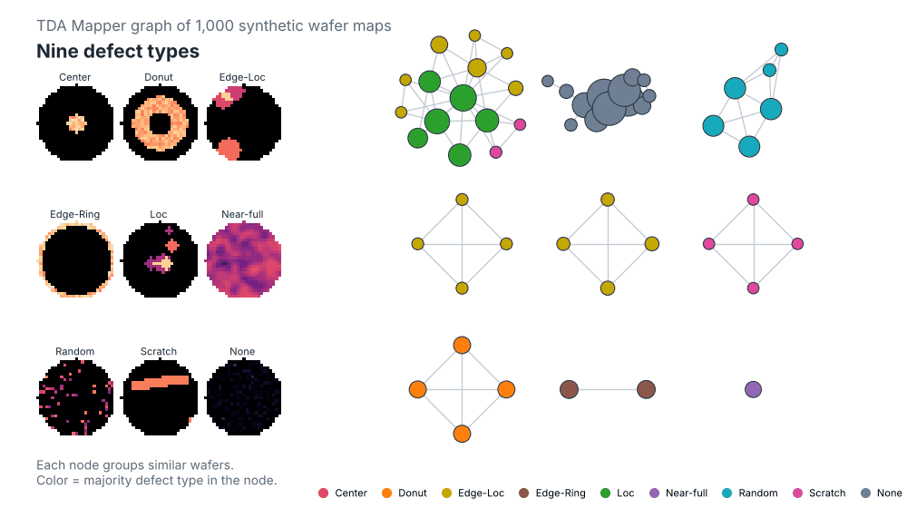
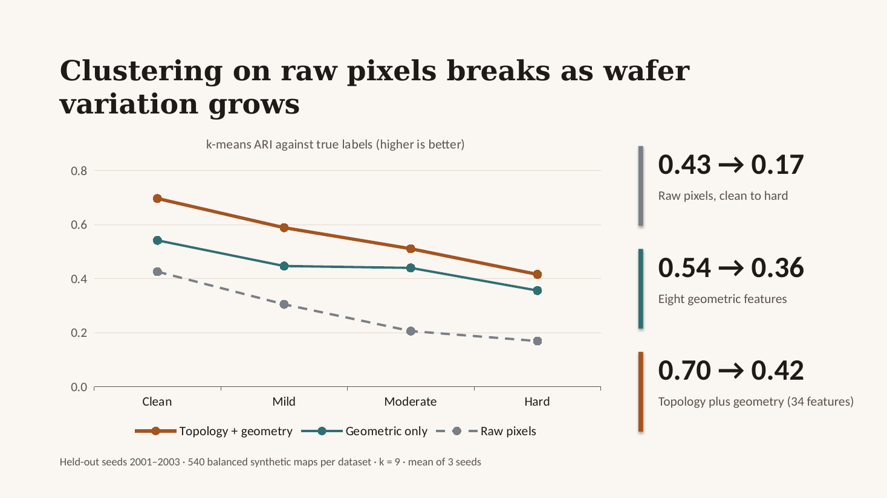
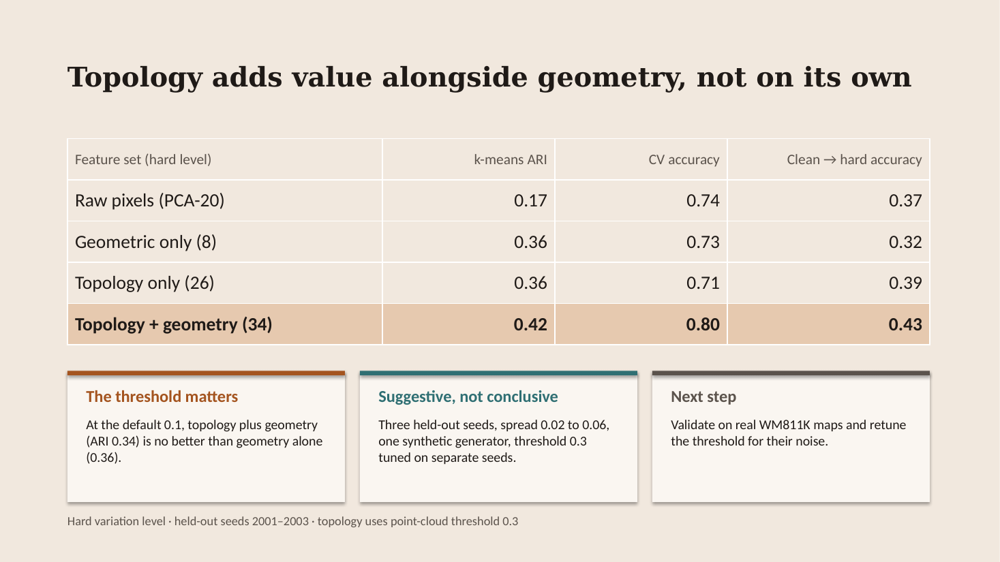
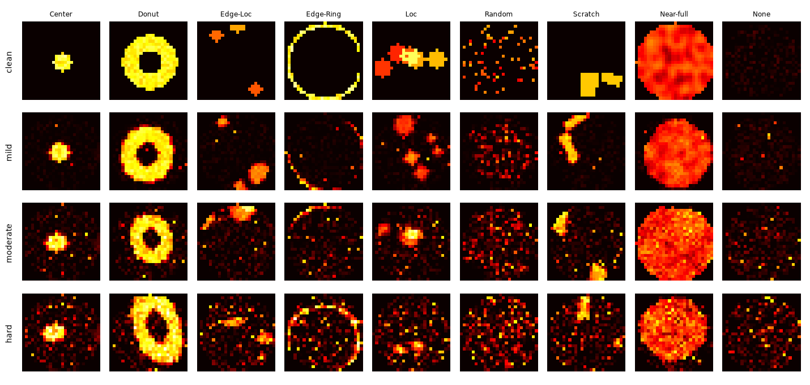

# Wafer Map TDA: Persistent-Homology Features and Mapper Graphs for Wafer Defect Patterns

## Georgia Tech Guest Lecture

### Deep Topological Data Analysis for Semiconductor Data Mining
**Guest lecturer:** Dr. Janhavi Giri  
**Course:** [ECE 8803 AI4: AI and Machine Learning for Semiconductor Manufacturing and Digital Twins](https://syllabus.gatech.edu/syllabi/8803/ai4)  
**Semester:** Fall 2026
The lecture introduces persistent homology and deep TDA, illustrates applications to semiconductor data, and explores future directions with agentic AI.
[Download the lecture slides (PowerPoint)](lecture-slides/DTDA-for-Semiconductor-Data-Mining%20-JGiri-Georgia-Tech-Final-10-26-Compressed.pptx) | [Lecture Recording (Youtube)](https://youtu.be/t09v_e3g_M0?si=6W0-RhbS1PnBcvgg)

### Hands-on exercise
Generate synthetic wafer maps, extract topological features, classify defect patterns, and explore Mapper graphs.
[](https://colab.research.google.com/github/janhavi-giri/wafer-map-tda/blob/main/notebooks/wafer_map_tda_reviewed.ipynb)

**Challenge:** How much does topology add beyond geometric features, and how does that change with noise? See [Try it yourself](#try-it-yourself) for suggested experiments.

### Citing this lecture
If you find this lecture useful or build on its material in your research, teaching, or software development, please cite:
Giri, J. (2026). *Deep Topological Data Analysis for Semiconductor Data Mining* [Guest lecture slides]. ECE 8803 AI4, Georgia Institute of Technology.
https://github.com/janhavi-giri/wafer-map-tda/tree/main/lecture-slides

For code used in your work, please also cite the software using the repository’s `CITATION.cff`. Cite original research papers separately when building on methods or results discussed in the lecture.

## About this repository

Learn how **topological data analysis (TDA)** can describe wafer defect patterns. The notebooks generate synthetic wafer maps, turn each one into persistent-homology features, classify nine defect types, and explore the feature space with UMAP, t-SNE, k-means and a Mapper graph.

[](https://colab.research.google.com/github/janhavi-giri/wafer-map-tda/blob/main/notebooks/wafer_map_tda_reviewed.ipynb)



The nine patterns (Center, Donut, Edge-Loc, Edge-Ring, Loc, Random, Scratch, Near-full, None) are hand-designed and inspired by WM811K category names. This repository contains no measured WM811K data and does not show production fab performance.

## Quick start

You need Python 3.10 or newer.

```bash
git clone https://github.com/janhavi-giri/wafer-map-tda.git
cd wafer-map-tda
python -m venv .venv
source .venv/bin/activate        # Windows: .venv\Scripts\activate
python -m pip install -e '.[notebook]'
jupyter lab notebooks/wafer_map_tda_reviewed.ipynb
```

Run the cells from top to bottom. On Google Colab, click the badge above and run the first code cell, which installs the package.

## Notebooks

| Notebook | What it does | Run time |
|---|---|---|
| [`wafer_map_tda_reviewed.ipynb`](notebooks/wafer_map_tda_reviewed.ipynb) | Main walkthrough: data, features, classifier, held-out test, UMAP, t-SNE, k-means, Mapper | about 1 minute |
| [`wafer_tda_mapper_eps2_all_classes.ipynb`](notebooks/wafer_tda_mapper_eps2_all_classes.ipynb) | Mapper graph of the training set with every defect type visible (outputs saved) | about 15 seconds |

Run times were measured on one cloud CPU; a laptop may differ. A harmless UMAP warning about `n_jobs` appears because a random seed is set.

## What the pipeline does

1. Generate 26 × 26 intensity maps inside a circular wafer mask.
2. Keep up to 500 pixels above intensity 0.1 and use their x/y coordinates as a point cloud.
3. Compute Vietoris-Rips persistence with Ripser.
4. Summarize the persistence diagrams and Betti curves, then add intensity and geometric features.
5. Train a random forest (SVM, gradient boosting and logistic regression are also available).
6. Explore the feature space with UMAP, t-SNE, PCA with k-means, and Mapper.

The default demo uses H0 and H1, which gives **34 features**: 18 persistence statistics, 8 Betti-curve summaries and 8 intensity and geometric descriptors. Set `max_dimension=2` for the original 47-feature definition; it adds the H2 features and is much slower. The feature names are explained in [`docs/EXPLANATION.md`](docs/EXPLANATION.md).

## Expected results

These come from a fresh install on Python 3.13 (numpy 2.5, scikit-learn 1.9). Small differences are normal across library versions.

| Check | Result |
|---|---|
| Held-out split accuracy (200 maps) | 0.975 |
| 5-fold cross-validation accuracy | 0.965 ± 0.014 |
| Second synthetic dataset (1,000 maps) | 0.978 |
| k-means silhouette / ARI / NMI | 0.467 / 0.375 / 0.644 |
| Mapper (DBSCAN eps 2.0) | 53 nodes, 944 of 1,000 maps covered |

The environment and checks are listed in [`docs/VALIDATION.md`](docs/VALIDATION.md).

## Use the package

```python
import numpy as np
from wafer_map_tda import SyntheticWaferMapGenerator, TDAFeatureExtractor, WaferDefectClassifier

np.random.seed(42)
generator = SyntheticWaferMapGenerator()
# Fixed counts avoid rare-class failures in stratified splitting and five-fold CV.
samples = [generator.generate_wafer_map(kind)
           for kind in ('Center', 'Donut', 'None') for _ in range(20)]
maps = np.array([sample[0] for sample in samples])
labels = [sample[1] for sample in samples]
classifier = WaferDefectClassifier(TDAFeatureExtractor(max_dimension=1))
results = classifier.train(maps, labels)
```

## Does TDA beat conventional clustering? We tested it

**Question.** On the default synthetic maps, simple features already separate the classes. Does topology help once the maps look more like real fab data?

**Process.**
1. Added an opt-in `variation` option to the generator (noise, speckle, size and position jitter, anisotropic stretch, rotation) with presets `clean`, `mild`, `moderate` and `hard`.
2. Compared four feature sets: raw pixels (PCA-20), eight geometric features, 26 topology features, and topology plus geometry. Each was scored three ways: unsupervised k-means and Ward clustering (adjusted Rand index against the true labels, k = 9), supervised random-forest cross-validation, and training on clean maps and testing on varied ones.
3. First pass on seeds 42, 7 and 123 with the default topology settings.
4. Follow-up with a protocol fixed in advance: pick the point-cloud threshold on two dev seeds (42, 7), then evaluate once on three fresh held-out seeds (2001 to 2003), with nothing changed afterwards.

**Outcomes (hard variation level, held-out seeds).**

| Features | k-means ARI | CV accuracy | Train clean, test hard |
|---|---|---|---|
| Raw pixels (PCA-20) | 0.17 | 0.74 | 0.37 |
| Geometric only (8) | 0.36 | 0.73 | 0.32 |
| Topology only (26) | 0.36 | 0.71 | 0.39 |
| **Topology + geometry (34)** | **0.42** | **0.80** | **0.43** |

- Clustering on raw pixels fails as variation grows (ARI 0.43 on clean maps down to 0.17).
- Topology plus geometry is the best or tied-best feature set at every level, but only with a noise-aware point-cloud threshold (`TDAFeatureExtractor(point_cloud_threshold=0.3)`). With the default 0.1 it is no better than geometry alone at the hard level.
- Topology on its own is not better than the simple geometric features. The benefit comes from combining them.
- A lifetime-profile representation of the persistence diagrams did worse than the summary statistics.
- Limits: three held-out seeds (seed spread 0.02 to 0.06), one synthetic generator, and a threshold tuned on that same generator. Treat this as suggestive evidence, and retune on real WM811K maps before relying on it.




Slides: [`PowerPoint`](docs/clustering_vs_tda_slides.pptx) · [`PDF`](docs/clustering_vs_tda_slides.pdf). Full tables, protocol and caveats: [`docs/VARIATION.md`](docs/VARIATION.md). Reproduce with `python scripts/variation_comparison.py OUTPUT_DIR` and `python scripts/topology_variants.py OUTPUT_DIR`.



## Try it yourself

- Compare geometry-only (the last 8 features), topology-only (the first 26) and combined models on the same split. How much does topology add?
- Set `max_dimension=2`. How many maps have any H2 bars, and how much slower is it?
- In the Mapper notebook, change DBSCAN `eps` from 2.0 to 1.0. Which defect types drop out of the graph, and why?
- Use `variation="hard"` and sweep `point_cloud_threshold` in `TDAFeatureExtractor`. How does the threshold interact with the noise level?

## Limitations

- The data is synthetic and both datasets come from the same generator, so scores do not show real-fab generalization.
- With the default settings several classes are easy to separate, and the point cloud ignores intensity, so Donut, Edge-Ring and Center maps produce identical point clouds. Use the `variation` option for harder data.
- Three of the 34 features are constant (`H0_birth_mean`, `H0_birth_std`, `intensity_min`).
- k-means uses the known class count (k = 9), and the exploration and Mapper steps run on the second dataset, not the training set.

The full list of fixes and open questions is in [`docs/REVIEW.md`](docs/REVIEW.md).

## Repository layout

```text
src/wafer_map_tda/   generator and feature extractor / classifier
notebooks/           walkthrough and Mapper notebook
docs/                explanation, review, validation notes, GIF, variation study and slides
scripts/             variation and threshold experiments
tests/               regression and smoke tests
```

Run the tests with `python -m unittest discover -s tests -v`.

## License

Released under the [MIT License](LICENSE). You may use, modify and share the code, including in coursework and research, as long as the copyright notice is kept.

## Citation

If you use this repository in your work, please cite it. GitHub also provides a ready-made citation from the "Cite this repository" button, which reads `CITATION.cff`.

```bibtex
@software{giri_wafer_map_tda_2026,
  author  = {Giri, Janhavi},
  title   = {Wafer Map TDA: Persistent-Homology Features and Mapper Graphs for Wafer Defect Patterns},
  year    = {2026},
  version = {1.0.0},
  url     = {https://github.com/janhavi-giri/wafer-map-tda}
}
```
